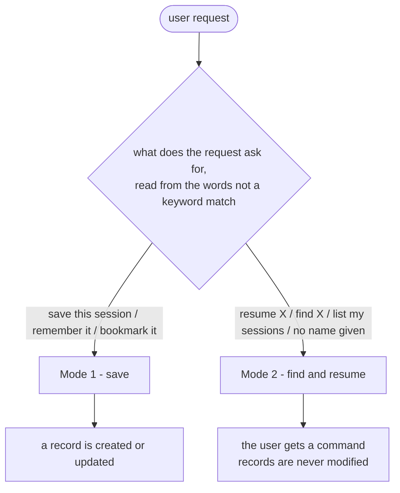
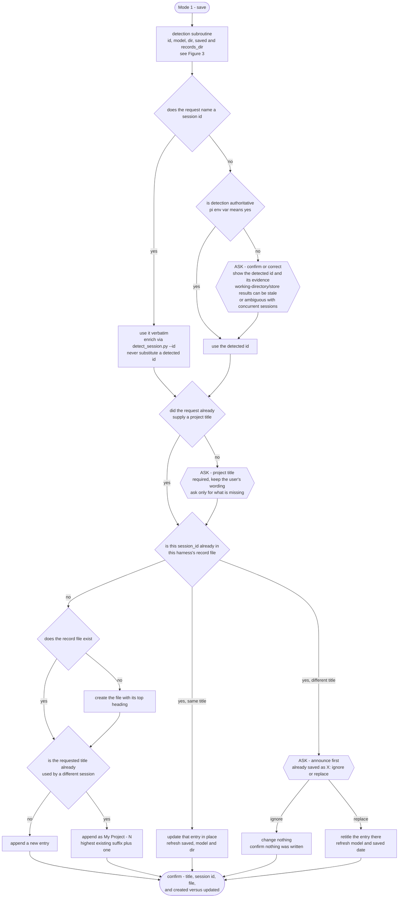
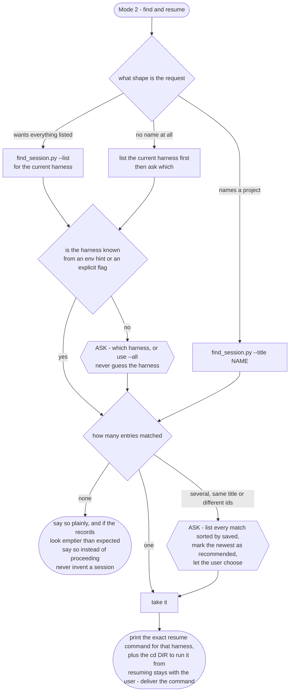
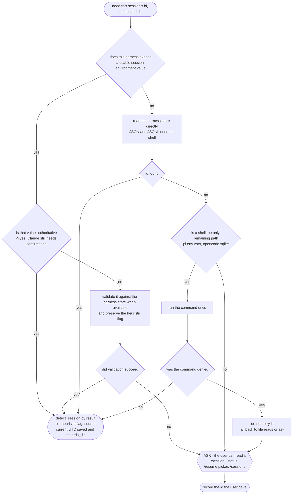

# Decision flow

Visual companion to `SKILL.md` — **SKILL.md is authoritative**; this file is derived from
it and must be updated together. Run `scripts/check_flow_doc.py` to catch drift: it verifies
every decision point appears in both files, and that **every numbered step and every section**
of SKILL.md is either covered by a figure or explicitly declared out of scope.

Why the figures are split by **mode** rather than by operation: a flowchart answers "given
this request, what happens next?", and one request enters exactly one mode. Per-operation
diagrams would force the reader to hold state and re-enter at the right node — the exact
place models slip. Logic used by only one mode (id resolution) lives inside that mode's
figure.

The one deliberate exception is **Figure 3, detection**: it is a subroutine entered from
Mode 1 step 1, it has its own ordered fallbacks, and inlining it would make Figure 1
unreadably wide. It is marked as a subroutine rather than pretended to be a mode.

Hexagons (`ASK`) mark **interaction points** — every place the skill must stop and ask the
user rather than decide. In prose these are easy to skim past; here they are unmissable.

## Figure 0 — routing



## Figure 1 — Mode 1, save



## Figure 2 — Mode 2, find and resume



## Figure 3 — detection subroutine

Entered from Mode 1 step 1. The order matters more than the mechanics: file reads work
everywhere, a shell does not.



## Entry shape (artifact, not flow)

Figures 1 and 2 read and write entries in this shape.

```markdown
# Sessions — <Harness>

## <project title>
- saved: 2026-10-16T23:40:00Z
- session_id: <id in that harness's own format>
- model: <provider/model>
- dir: <absolute working directory>
```

- Exactly the four fields: `saved` (UTC, ISO-8601), `session_id`, `model`, `dir`.
- If the file does not exist, create the file with its top heading first.
- Entries append oldest-first, so file order is the timeline; `saved` shows freshness.

## Invariants (not flow)

These hold everywhere and have no branch, so putting them in a figure would imply they are
optional somewhere. They live in `SKILL.md` under Rules and Entry identity.

| Invariant | Why it matters |
|---|---|
| One record file per harness | Session ids do not translate across harnesses; mixing them corrupts lookups |
| An entry is identified by its `session_id`, never its title | The id is what a resume command consumes; titles are only human labels |
| A session id is never fabricated | A wrong id is worse than an admitted gap — ask the user instead |
| Mode 2 never writes | Read paths must be safe to run anytime |
| Entry loss is announced | If the records look emptier than expected, say so instead of proceeding — quiet loss is the one failure saving cannot see |
| Resuming stays with the user | Deliver the command line; never spawn an interactive harness process to test it |
| Ask only for what is missing | Normally just the project title; do not interrogate for values detection can produce |
| Destination order: request-named → `AGENTS_MEMORIES_DIR` → `~/.agents/memories/sessions/` | An explicit destination must always win, or tests and project-local records break |
| No secrets in records | These files are plain text and often committed |

Harness → storage / model / resume mapping stays in the `SKILL.md` table, and the resume
commands are authoritative in `scripts/find_session.py`; they are deliberately not copied
here.
